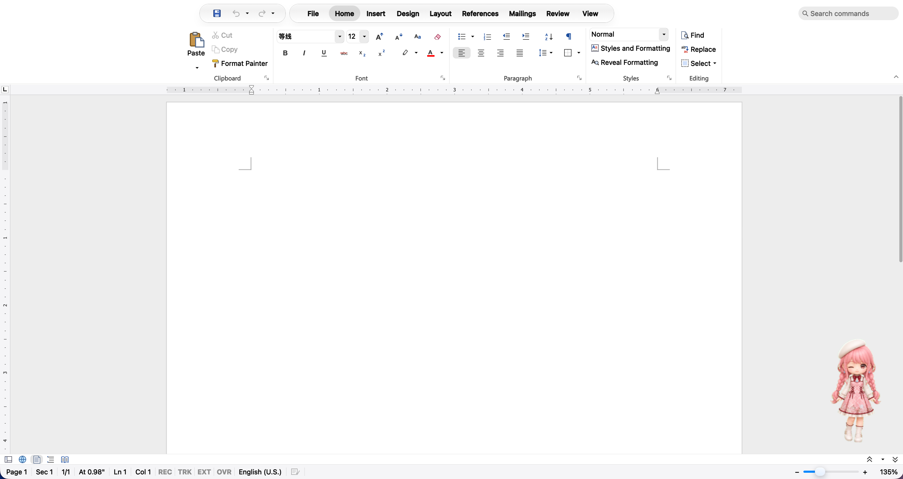
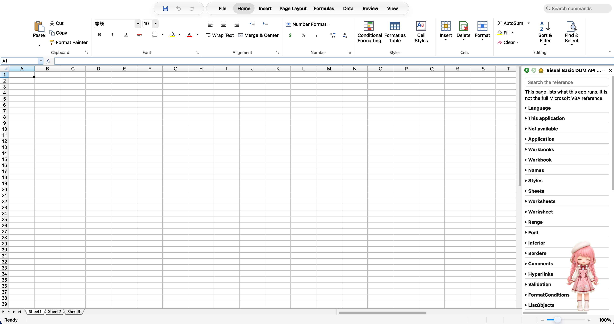
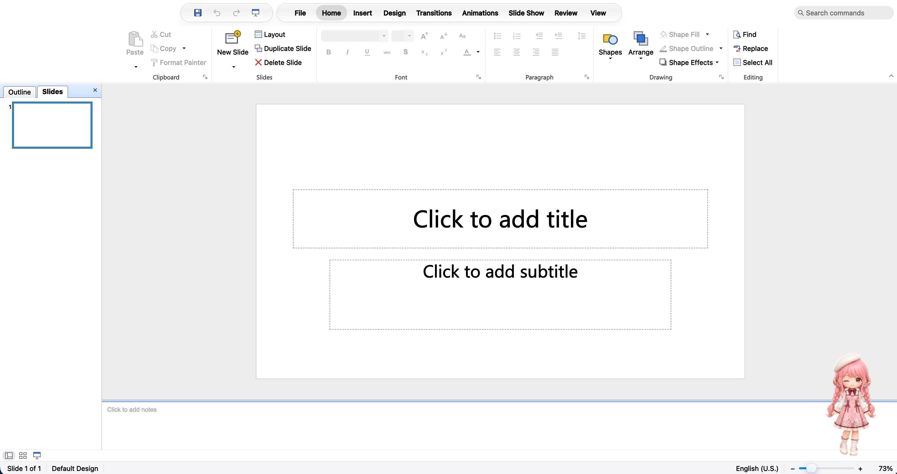
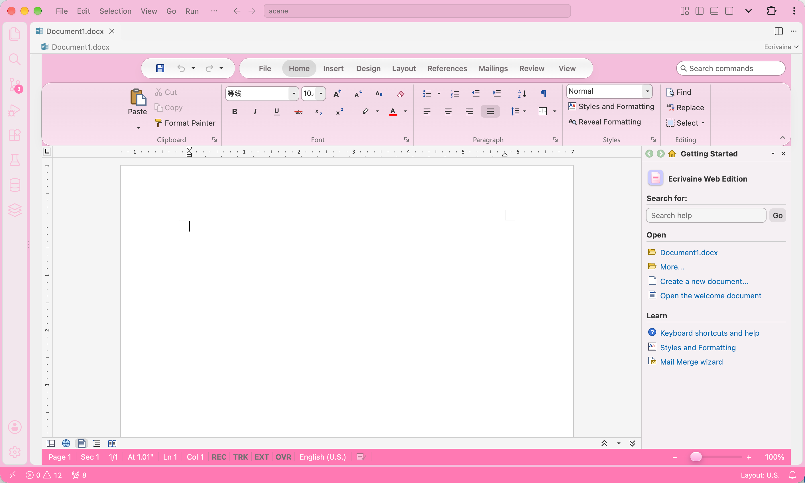
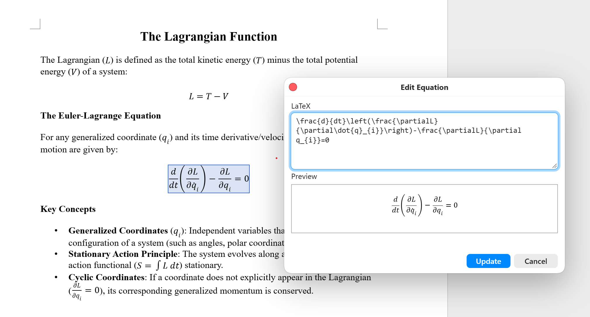

<h1 align="center">VibeOffice</h1>

  <b>A word processor, a spreadsheet and a presentation editor that run in your browser.</b> 
  They open and save real .docx, .xlsx and .pptx files. Nothing to install, no account, and your files never leave your computer.

  <a href="https://acane77.github.io/vibeoffice"><b>▶&nbsp;&nbsp;Try it now!</b></a>

<table>
  <tr>
    <td align="center" width="33%">
       
      <b><a href="https://acane77.github.io/vibeoffice/quire/">Quire</a></b> Word processor
    </td>
    <td align="center" width="33%">
       
      <b><a href="https://acane77.github.io/vibeoffice/ledger/">Ledger</a></b> Spreadsheet
    </td>
    <td align="center" width="33%">
       
      <b><a href="https://acane77.github.io/vibeoffice/lectern/">Lectern</a></b> Presentations
    </td>
  </tr>
</table>

## VSCode and Code Server Plugin

This fork implements a vscode/code-server plugin, it works in VSCode!

<table>
  <tr>
    <td align="center" width="33%">
       
      <b><a href="https://github.com/acane77/VibeOffice-vscode-plugin/releases">VS Code Plugin</a></b> 
    </td>
    <td align="center" width="33%">
      &nbsp;
    </td>
    <td align="center" width="33%">
      &nbsp;
    </td>
  </tr>
</table>

Open a `.docx`, `.xlsx` or `.pptx` from the Explorer and the app opens in editor tab.

## Why VibeOffice

- **Familiar.** The Office 2010 ribbon (the default look). Windows 7, Windows XP, Classic, Paper and Paper 2016 are under Themes.
- **Lossless editing.** Open what colleagues send you, and save files built to open in Microsoft Office and LibreOffice, without losing what you didn't touch (below).
- **Private.** Everything runs on your machine. There is no server behind it, no upload and no sign-in.
- **Installable.** In Chrome or Edge, install it from the Start Center. It then opens .docx, .xlsx and .pptx files from your file manager. The same pages run inside VS Code and code-server: [docs/vscode.md](docs/vscode.md).

## Lossless editing

The goal: edit a Word, Excel or PowerPoint file here, save it in the same format, and send it to someone who uses Microsoft Office. It opens for them without an error or repair message, with your changes in place and everything else exactly as it was.

- **What VibeOffice can't edit for now, it keeps.** VBA macros, embedded objects, SmartArt in layouts it does not have, video and audio, ink, 3-D models, custom XML and Office's newer extensions are written back byte for byte. Content it does edit keeps its original names and IDs, so links, comments and animations still point where they did.
- **Edits change only what you changed.** Move or resize an object VibeOffice can't edit, and only its position changes. Set a shape's shadow, and its unsupported attributes stay.
- **Each app's own features survive:**
  - **Word:** content controls and their data bindings, comments, watermarks, section and numbering properties.
  - **Excel:** pivot tables (refreshed by Excel when their source changed), slicers and timelines, threaded comments with @mentions, form controls, query tables.
  - **PowerPoint:** media, sections and custom shows, comments, unused slide layouts, tags, actions and effects.
- **Nothing lost silently.** If a save would drop something you would miss, the Compatibility Checker will show a warning.

4,697 real files from public test collections (LibreOffice, Apache POI, Open XML SDK) are opened, saved, edited, undone and recovered, and every save is compared with the original. Where the apps stand today, the known gaps and what comes next: [docs/LOSSLESS_SAVE.md](docs/LOSSLESS_SAVE.md).

## Equations LaTeX

I personally found Apple Pages' equation editor is easier to use than Word's during the experience when I was completing my Master degree's thsis, so this one is inspired by it: type the formula in LaTeX. Word opens the file and shows the same formula.

  

## The apps

| App | | Opens and saves |
|---|---|---|
| [Quire](docs/quire.md) | Word processor | .docx, .docm, .dotx, .dotm, .rtf, .htm, .txt, Markdown (.md, or .zip with pictures); PDF |
| [Ledger](docs/ledger.md) | Spreadsheet | .xlsx, .xlsm, .xltx, .xltm, .csv, XML Spreadsheet 2003, .htm; PDF |
| [Lectern](docs/lectern.md) | Presentations | .pptx, .pptm, .ppsx, .ppsm, .potx, .potm; PDF, PNG, .htm |

Start at the Start Center: open a file, pick one from Recent Files, or create a document, spreadsheet or presentation from a blank page or a template.

## Feedback and contributing

Found a file that doesn't open or save the way it should? Please [open an issue](https://github.com/tcchen2026/VibeOffice/issues).

VibeOffice is plain HTML and JavaScript with no build step. Read [AGENTS.md](AGENTS.md) for the design rules and [docs/testing.md](docs/testing.md) for running it locally and testing.

## Legal

**License: Apache License 2.0**, see [LICENSE](LICENSE) (see below about code from other projects).

**Independent.** VibeOffice is not affiliated with, endorsed by or sponsored by Microsoft Corporation, The Document Foundation or any other maker of office software. Microsoft, Word, Excel, PowerPoint and Office are trademarks of Microsoft Corporation, and LibreOffice is a trademark of The Document Foundation. Other names are trademarks of their owners. They appear here only to say which files VibeOffice works with and which programs it was tested against. In the apps, menu, command and template names follow Office's where people know them, so the apps feel familiar.

**How compatibility was built.** VibeOffice reads and writes Office Open XML, the file format published as the standards ECMA-376 and ISO/IEC 29500. It is written from those standards and from the format documentation Microsoft publishes. Compatibility is checked from the outside, side by side: files from public test collections are opened, edited and saved, and the results are compared with what other programs make of the same files. LibreOffice and Microsoft Office are used in testing, as installed programs, to check that files work in both; no code from either is part of VibeOffice. VibeOffice was not built by examining Office's program code: no decompiling or disassembling, and no confidential documentation.

**How the code is reviewed.** VibeOffice is written with the help of AI coding assistants. Such tools are trained on large amounts of public code, which may include LibreOffice and other office software, and can occasionally produce code that resembles their training material. To reduce that risk, VibeOffice's code is reviewed on an ongoing basis against the open-source projects it could most plausibly resemble: office suites such as LibreOffice, Apache OpenOffice, OnlyOffice and Gnumeric, and common open-source libraries. Code that matches or closely resembles work under terms VibeOffice does not accept is removed and rewritten independently, from published standards and mathematics, or replaced by an equivalent under a compatible licence. Code that matches permissively licensed work is kept and credited, as its licence requires. The project's contribution rules ([AGENTS.md](AGENTS.md)) apply the same terms to all new code. The first full review was completed in October 2026.

**Code from other projects.** VibeOffice uses, or translates into JavaScript, only code under licences compatible with its own; that code is credited, with its licence, at [oss-licenses.html](https://acane77.github.io/vibeoffice/oss-licenses.html). If you believe something in VibeOffice comes from your work without credit, please [open an issue](https://github.com/tcchen2026/VibeOffice/issues): we take such reports seriously and review each one.

**Artwork.** The icons, clip art, app icons, Scout's drawing and the sample documents are original. Nikki (暖暖), the other assistant, is a sprite from [codex-pets.net](https://codex-pets.net/#/pets/nikki-bloom-poetry); her name and likeness are the copyright of Papergames (叠纸), also known as Infold, and that sprite is not licensed for commercial use. The menus and toolbars follow the general style of a classic desktop office suite; no artwork was copied from one.

**No warranty.** VibeOffice is provided as is, without warranty of any kind (see [LICENSE](LICENSE)). Keep a copy of any file that matters before you edit it here.
